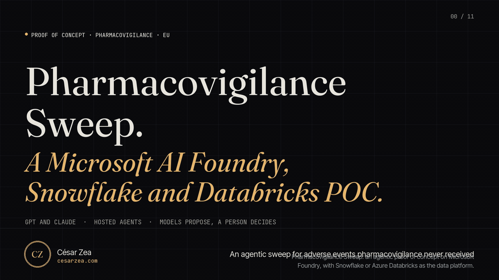

# Pharmacovigilance Sweep



The subtitles carry the narration. A twelve-minute walkthrough of what it does, how it does it,
how it is built and how it is measured is in [docs/demo/full.gif](docs/demo/full.gif) (5 MB) and,
with voice, as a video attached to the latest release. The scripts, frames and the commands that
rebuild everything are in [docs/demo/](docs/demo/).

## The problem

A pharmacovigilance (PV) department only sees the adverse events that reach it. Every day, side
effects are mentioned in channels nobody in PV reads: medical information call logs, sales reps' CRM
notes, patient support programme nurse notes, quality complaints, social media. EU rules (GVP Module
VI) make the company responsible for all of them, with a 15-day clock for serious cases that starts
the day anyone in the company, or a vendor working for it, first hears of the case. Reports that
stay in those channels are late, or missing, when an inspector asks.

## What the solution does

Pharmacovigilance Sweep re-reads those records after the fact and, for each one:

1. **Screens** whether it describes an adverse event or a special situation (overdose, pregnancy,
   lack of effect, and so on).
2. **Extracts** the case facts with the evidence quotes: patient, reporter, product, event,
   seriousness, dates.
3. **Applies the rules**: is it our product, is it serious, when is day 0, what is the regulatory
   deadline, was the vendor's forwarding timeline met.
4. **Matches** it against what PV already holds, through an agent with read-only tools over the
   safety database, the intake queue and the vendor log: new case, already received, follow-up.
5. **Produces a prioritised finding** with a proposed case intake package.
6. **Reconciles** what vendors say they forwarded against what PV received.

A PV reviewer works the queue in a review app and records the outcome; nothing is closed by a model.

## What you get

- The potential cases PV never received, ranked by seriousness and regulatory clock, each with a
  case intake package ready to confirm.
- Late-submission and forwarding-breach findings with a root cause, and a vendor reconciliation.
- A measured comparison of GPT and Claude on the same 450 records, graded by Foundry evaluators.
- All of it deployable from scratch by the scripts in this repository, on Microsoft Foundry with
  Snowflake or Azure Databricks as the data platform. Public and synthetic data only; not a
  validated system.

## Where to read more

- What it does and why: [docs/poc-definition.md](docs/poc-definition.md)
- How it is built: [docs/architecture.md](docs/architecture.md)
- What it is worth and what it costs: [docs/business-case.md](docs/business-case.md)
- What was verified, with numbers: [docs/ops/spike-log.md](docs/ops/spike-log.md)
- Provider comparison on 450 records: [docs/ops/comparison-round3.md](docs/ops/comparison-round3.md)
- Snowflake setup: [docs/ops/snowflake-setup.md](docs/ops/snowflake-setup.md) ·
  Databricks: [docs/ops/databricks.md](docs/ops/databricks.md) ·
  Unattended runs: [docs/ops/runner-job.md](docs/ops/runner-job.md)

## Results in one table

450 synthetic records across five channels, screening and extraction on the small model, matching by
an agent on the large model with read-only tools over the safety database, intake queue and vendor
log (round 3; details and caveats in the spike log and the business case).

| | GPT (`gpt-5-4-mini`) | Claude (Haiku 5.5 + Sonnet 5.5 agent, on Foundry) |
|---|---|---|
| Screening recall / precision | 0.997 / 1.0 | 0.976 / 0.997 |
| Extraction valid | 0.995 | 1.0 |
| Causality statement | 0.901 | 0.938 |
| Matching outcome | 0.835 | 0.954 |
| Model cost per sweep | about $11 | about $11 |

The hosted agents, the review app and the unattended job were verified on Snowflake and on
Databricks with 8-record samples; the Databricks copy holds the results copied from Snowflake, not
recomputed.

## Layout

```
infra/          Bicep: Foundry resource, project and model deployments, budget, registry, identities,
                Key Vault and Container Apps job, project connections, Databricks workspace
agent/          Hosted matching agent image (Microsoft Agent Framework, Invocations protocol)
runner/         Python: data staging (pvsweep_load), synthetic data (pvsweep_synth), sweep runner
                (pvsweep_runner: local DuckDB, Snowflake and Databricks backends), matching agent
                package (pvsweep_agent), tests
prompts/        Versioned prompts and JSON schemas for screening, extraction and matching
snowflake/      Bootstrap, versioned migrations, load script, Streamlit review app
databricks/     The same platform for Unity Catalog: bootstrap, migrations, load, review app
config/         Fictional brands of the fictional marketing authorisation holder
data/synthetic/ Committed synthetic records and their ground truth (scenario-first)
data/eval/      Exports graded by the Foundry evaluators
scripts/        Deployment helpers: hosted agents, Key Vault secrets, job runs, Snowflake and
                Databricks setup, migrations, loads, result sync, review apps
docs/           Definition, architecture, business case, operational notes
Makefile        One target per step; `make -n <target>` shows the command
```

## Deploy from scratch

Prerequisites: Azure CLI logged in with Owner on a pay-as-you-go subscription, `uv`, Snowflake CLI
and a Snowflake account in an EU region (any cloud), or a Databricks workspace which `make deploy`
can create. Secrets never enter the repository: Snowflake keys live in `.secrets/` (git-ignored) and
reach Azure through Key Vault and a Foundry project connection; connection ids live in `.env`.

```bash
cp infra/main.parameters.json infra/main.parameters.local.json   # fill in your values
make deploy             # Azure: Foundry, models, budget, registry, identities (Sweden Central)
make build-agent        # agent image into the registry
make deploy-agents      # hosted matching agents (GPT and Claude) in Foundry Agent Service
make snow-bootstrap     # once, as ACCOUNTADMIN: roles, warehouse, database, service users
make snow-migrate       # schemas, tables, views, grants
make snow-load          # public datasets -> Parquet -> Snowflake
make snow-app           # Streamlit review app in Snowflake
```

Optional: `make deploy DEPLOY_RUNNER=1`, `make kv-secrets` and `make run-sweep-job` run the sweep as
an Azure Container Apps job; `make deploy DEPLOY_DATABRICKS=1` followed by the `dbx-*` targets sets up
the Databricks platform and copies the processed results from Snowflake. `make teardown` removes
everything in Azure.

## Run locally without a cloud data platform

The runner has a DuckDB backend over the staged Parquet files and the committed synthetic data; the
models still run on Foundry:

```bash
make stage-data
uv run --project runner python -I -m pvsweep_runner sweep --account <foundry-account> \
  --project-endpoint https://<foundry-account>.services.ai.azure.com/api/projects/<project> \
  --provider gpt --small gpt-5-4-mini --match agent --limit 40
```

`--backend snowflake` or `--backend databricks` runs the same sweep on the cloud platform;
`--match hosted` uses the hosted agents instead of the in-process one. `--provider claude-direct`
uses the Anthropic API with `ANTHROPIC_API_KEY` from `.env` (development only; the evaluated path is
Claude on Foundry). Evaluate a run with `python -I -m pvsweep_runner.evaluate --db <file>` and compare
two runs with `pvsweep_runner.compare`; `pvsweep_runner.snapshot` copies a cloud run into a local file.

## Development

```bash
cd runner && uv sync && uv run pytest -q && uv run ruff check .
```

CI runs the tests and lint on every push; the deployment workflow is manual and uses OIDC, with the
parameters file as the only secret.

## Data and licences

FAERS (CC0) and VAERS (CC0 / Apache 2.0) are downloaded at load time at pinned revisions and never
committed. MedDRA and the EMA IME list are bring-your-own files; demo mode uses a term vocabulary
derived from the public data and a short project-defined serious-event list, neither presented as
the licensed artefacts. Brand names are fictional (checked against the Spanish and EU registers).

## Licence

MIT (see LICENSE).
