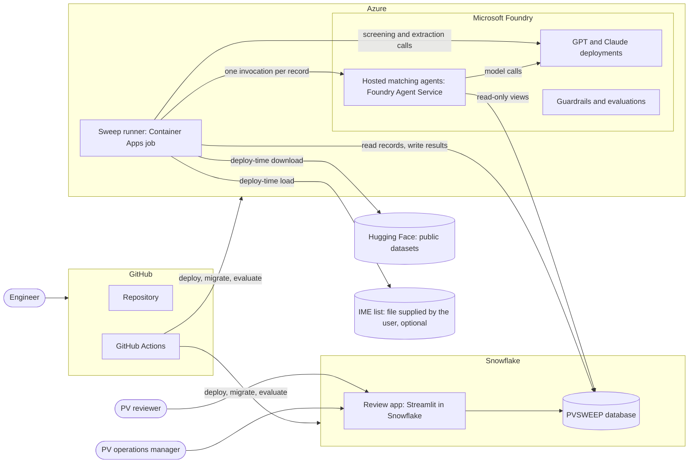
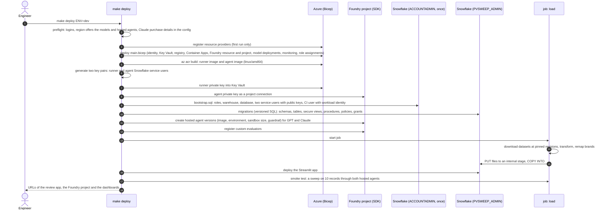
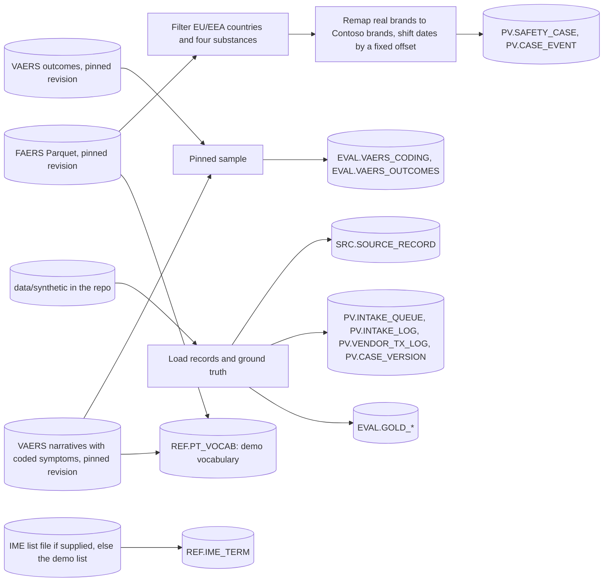
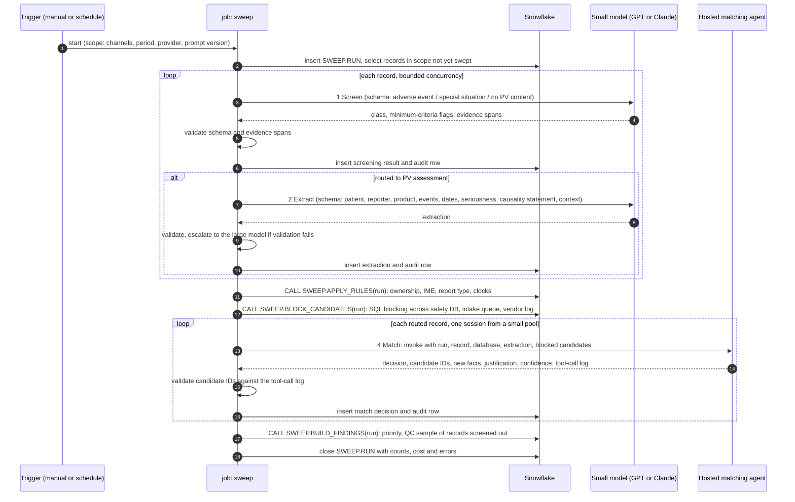
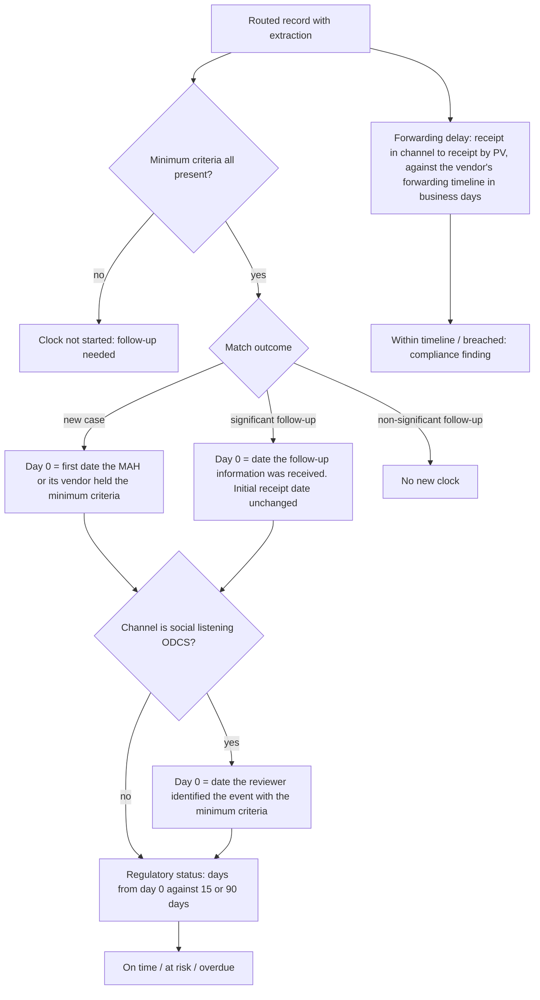
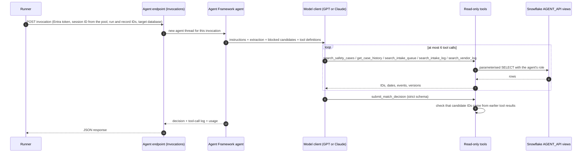
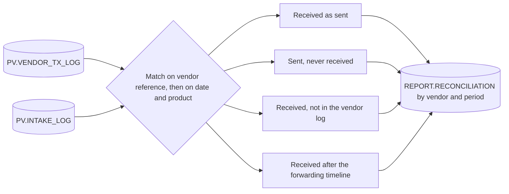
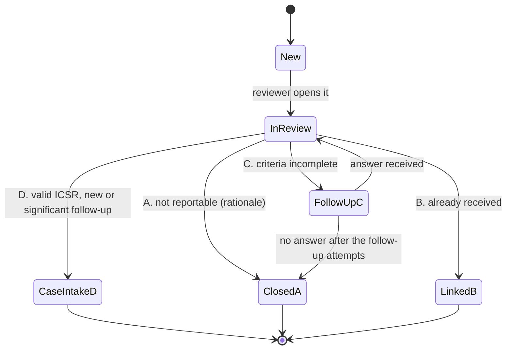
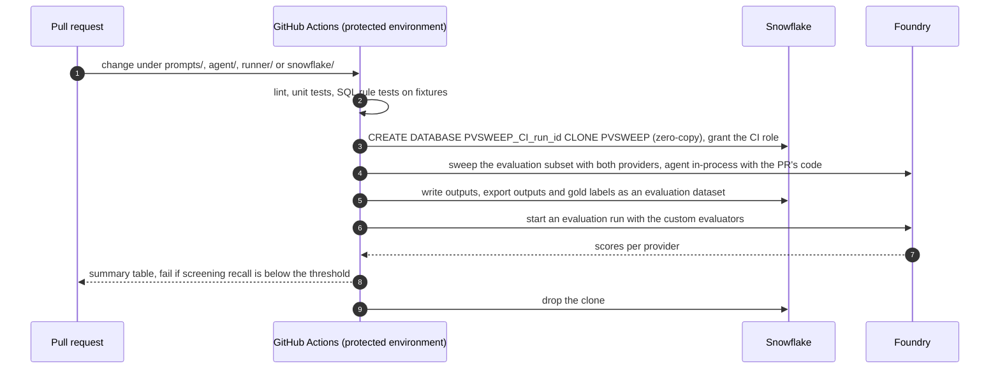

# Pharmacovigilance Sweep — Architecture and Flows

> Draft v0.3 (2026-11-22). Companion to [poc-definition.md](poc-definition.md) v0.3, which
> defines what the POC does. This document defines how it is built, deployed and run.

## 1. Drivers

| Driver | Consequence for the design |
|---|---|
| Everything runs in Snowflake or Azure | No other runtime. Public datasets are pulled at deploy time only |
| Deployable from scratch by script, public GitHub repo | Infrastructure as code, versioned SQL migrations, no secrets or licensed content in the repo |
| Microsoft Foundry is the AI platform, not just a model endpoint | The matching agent runs in Foundry Agent Service as a hosted agent; guardrails, model evaluations and agent traces live in Foundry |
| AI only where it is needed | Screening and extraction are single model calls; only matching is an agent. Rules, clocks, reconciliation, prioritisation and follow-up drafts are deterministic |
| A person decides | Models propose; the PV reviewer records every decision. Nothing is closed by a model |
| Inspection-ready | Every model call, agent run, rule result and decision is stored, append-only, with model, prompt and code versions |
| Two providers compared fairly | Same prompts, schemas, data, agent code and tools on GPT and Claude; results stored side by side |
| Snowflake trial account | No external network access from Snowflake, so model calls run in Azure and data is pushed into Snowflake |

Non-functional targets for the POC are modest: a sweep over about 450 records should cost a few
tens of dollars at most and be repeatable. There is no real-time path. Duration is bounded by
model quota: with the default pay-as-you-go Claude quota, a Claude sweep takes about two hours
(section 11). GPT quota is known once the resource providers are registered.

## 2. Context



Snowflake holds all data and all decisions. Foundry holds the models, the matching agent, the
guardrails and the model evaluations. A Container Apps job drives each sweep. GitHub holds the
code and runs deployment and evaluation.

## 3. Components

```mermaid
flowchart TB
  subgraph GH["GitHub"]
    WF1[deploy.yml]
    WF2[ci.yml: tests and evaluation]
  end

  subgraph AZ["Azure resource group"]
    UAMI[Runner managed identity]
    KV[Key Vault]
    ACR[Container registry: runner and agent images]
    subgraph CAE["Container Apps environment"]
      J1[job: load]
      J2[job: sweep]
    end
    subgraph FR["Foundry resource and project"]
      G1[GPT small: EU Data Zone]
      G2[GPT large: EU Data Zone]
      C1[Claude Haiku 5.5: Hosted on Azure, Global]
      C2[Claude Sonnet 5.5: Hosted on Azure, Global]
      A1[Hosted agent: pvsweep-matcher-gpt]
      A2[Hosted agent: pvsweep-matcher-claude]
      CON[Project connection: agent Snowflake key]
      GR[Guardrails]
      EVL[Custom evaluators and evaluation runs]
    end
    AI[Application Insights and Log Analytics]
  end

  subgraph SF["Snowflake account (EU region, Enterprise edition)"]
    WH[PVSWEEP_WH warehouse]
    subgraph DB["PVSWEEP database"]
      REF[REF]
      SRC[SRC]
      PV[PV]
      AAPI[AGENT_API]
      SW[SWEEP]
      RV[REVIEW]
      AUD[AUDIT]
      EV[EVAL]
      RP[REPORT]
    end
    ST[Streamlit review app]
  end

  WF1 --> AZ
  WF1 --> SF
  WF2 --> FR
  WF2 --> DB
  J1 & J2 --> UAMI
  UAMI --> KV
  J2 --> G1 & G2 & C1 & C2
  J2 --> A1 & A2
  A1 --> G2
  A2 --> C2
  A1 & A2 --> CON
  A1 & A2 --> AAPI
  J1 & J2 --> DB
  J1 & J2 & A1 & A2 --> AI
  ST --> DB
```



### Azure and Foundry

| Component | Purpose |
|---|---|
| Region | **Sweden Central**: the only European region that offers Claude on Foundry. It also offers hosted agents and the GPT models below as EU Data Zone Standard (checked 2026-11-22; the preflight re-checks) |
| Foundry resource and project | Model deployments, hosted agents, guardrails, evaluations, Foundry tracing. Entra ID authentication |
| GPT deployments | `gpt-5.4-mini` (small) and `gpt-5.5` (large), both generally available as EU Data Zone Standard in Sweden Central |
| Claude deployments | Claude Haiku 5.5 and Claude Sonnet 5.5, Global Standard, model version 2 (Hosted on Azure). The deployment carries the organisation, country and industry that accept the Azure Marketplace offer, so no manual step is needed |
| Hosted agents | `pvsweep-matcher-gpt` and `pvsweep-matcher-claude`: the same container image, with an environment variable that selects the model client. Each gets its own Entra agent identity and endpoint. Invoked through the Invocations protocol (JSON in, JSON out). Smallest sandbox size |
| Project connection | The agent's Snowflake private key, stored by Foundry in its Key Vault and injected into the sandbox as an environment variable at start |
| Guardrails | A content-safety guardrail on each hosted agent and Prompt Shields for document attacks on the GPT deployments. Coverage of Claude deployments is to be confirmed |
| Evaluations | Code-based custom evaluators (deterministic `grade()` functions against the gold labels) and evaluation runs per provider |
| Container Apps jobs | `load` (deploy-time data load) and `sweep` (one run of the pipeline). Manual or scheduled trigger |
| Runner managed identity | User-assigned. Calls models, invokes the hosted agents, reads the runner's Snowflake key from Key Vault |
| Key Vault | The runner's Snowflake private key |
| Container registry | Two images, `runner` and `agent`, built for linux/amd64 by `az acr build` |
| Application Insights | OpenTelemetry traces from the runner and the hosted agents (Foundry injects the connection string into the agents) |

### Snowflake

| Schema | Contents |
|---|---|
| `REF` | Products and fictional brands, substance map, channels with report type, vendors with their forwarding timeline, calendar, IME list, demo PT vocabulary, model price table, configuration |
| `SRC` | Source records from the five channels, one table with channel, record ID, receipt date in the channel, text and metadata |
| `PV` | Safety database extract (FAERS-derived cases and events, synthetic version history for the scenario cases), PV intake queue, PV intake log, vendor transmission log |
| `AGENT_API` | Secure views the agent's tools read: blocked candidates, case history, intake queue, vendor log. Nothing else is visible to the agent |
| `SWEEP` | Runs, screening results, extractions, rule results, match candidates, match decisions, findings |
| `REVIEW` | Reviewer decisions, follow-up requests, case intake packages, compliance findings, deviations, CAPAs, QC sample decisions |
| `AUDIT` | One row per model call and per agent invocation: run, record, step, provider, deployment, agent name and version, prompt version, schema version, effort, package versions, input and output hashes, raw output, tool-call log, tokens, latency, status |
| `EVAL` | Gold labels per scenario (screening class, reviewer outcome, match outcome, extracted facts), evaluation datasets exported to Foundry, evaluation run references |
| `REPORT` | Views for the reconciliation report, channel and vendor KPIs, model comparison |

Roles:

| Role | Rights |
|---|---|
| `PVSWEEP_ADMIN` | Owns objects; used only by deployment |
| `PVSWEEP_PIPELINE` | Runner: read `REF`, `SRC`, `PV`, `AGENT_API`; insert into `SWEEP`, `AUDIT`, `EVAL` |
| `PVSWEEP_AGENT` | Hosted agents: select on `AGENT_API` only |
| `PVSWEEP_REVIEW_APP` | Owner of the Streamlit app. Read everything needed for review; insert only into `REVIEW` |
| `PVSWEEP_REVIEWER` | Usage on the review app; unmasked view of patient fields |
| `PVSWEEP_ANALYST` | `REPORT` views only; patient fields and free text masked |
| `PVSWEEP_CI` | Like `PVSWEEP_PIPELINE` plus `PVSWEEP_AGENT`, on a cloned database |

No role used at run time has `UPDATE` or `DELETE` on `SWEEP`, `REVIEW` or `AUDIT`. Corrections
are new rows that point to the row they supersede; Time Travel covers recovery. Masking policies
need Snowflake **Enterprise edition**, so the trial account must be created as Enterprise.

## 4. Flow: deploy from scratch



- **One-time manual steps, stated in the README:**
  - create the Snowflake trial account (Enterprise edition, Azure, EU region) and have Owner rights
    on an Azure pay-as-you-go subscription;
  - put the organisation name, country and industry for the Claude purchase in the config: the
    Claude deployments accept the Azure Marketplace offer with them;
  - run the bootstrap once with `ACCOUNTADMIN`.
  Everything after that is scripted.
- **The Snowflake trial lasts 30 days** and is then suspended, so the build and the demo recording
  fit in that window. A new trial plus `make deploy` rebuilds everything.
- **Private keys** are generated at deploy time and written only to Key Vault (runner) and to a
  Foundry project connection (agent). They never touch the repository.
- **Hosted agents** are created with the Foundry Python SDK from the deploy script (`azd` is an
  alternative). The project's identity needs pull rights on the registry; the runner identity
  needs a role that allows invoking agents.
- **Synthetic data is committed.** The generator runs once, on request (`make synth`), and its output
  (records plus ground truth) is versioned in `data/synthetic/`. Deployment loads that output; it
  does not regenerate text, so every deployment gets the same data.
- **Teardown:** `make teardown` drops the Snowflake database, warehouse, roles and users with the
  bootstrap role, then deletes the Azure resource group, which removes the Foundry project, its
  agents and deployments. Resource names carry a random suffix, so soft-deleted Key Vaults do not
  block a redeploy.

## 5. Flow: data load



The load job runs outside Snowflake because a trial account has no external network access. The
loader (`runner/pvsweep_load`) downloads each pinned file once into a local cache (DuckDB's remote
range reads trip Hugging Face's per-IP rate limit), transforms with DuckDB, writes Parquet to
`data/stage/`, and `scripts/snow_load.sh` `PUT`s the files to an internal stage and `COPY`s them in.
Every load records the dataset, revision, row counts, date offset and licence in `REF.DATA_SOURCE`.

What the sources hold (checked 2026-11-22):

| Source | Content | Consequence |
|---|---|---|
| FAERS Parquet (CC0, about 350 MB) | Reports received June 2022 to December 2024: 2.9 million reports, 306,000 with an EU/EEA country of occurrence. As primary or secondary suspect in EU/EEA reports: venlafaxine 3,762 cases, sertraline 3,597, escitalopram 2,181, duloxetine 1,433. Tables for demographics, drugs, reactions (PT), outcomes, indications, therapy dates | Plenty of cases. No narratives. Only the latest version of each case, so `PV.CASE_VERSION` comes from the synthetic scenarios. Dates end in 2024, so they are shifted by a fixed offset |
| VAERS narratives with coded symptoms (CC0) | 2.6 million rows: age, sex, vaccine and symptom PTs as input, the reporter's narrative as output | Coding benchmark on a pinned sample |
| VAERS outcomes (Apache 2.0) | 1.8 million rows: report text and a label combining emergency-room visit, hospitalisation and death | Seriousness benchmark limited to hospitalisation and death: an emergency-room visit is not an ICH E2A criterion. The two VAERS datasets share no ID and cannot be joined |
| IME list | The EMA list is not offered as a public download and is built on MedDRA terms | Loader for a file supplied by the user; demo mode uses a short list defined by the project for the scenario events, labelled as not the EMA list |

## 6. Flow: one sweep



Screening and extraction stay as single calls in the runner: each is one input, one structured
output, with no decisions about what to look at next. An agent would add cost and variance for
nothing (ADR-009).

### Rules and clocks (step 3)

The rules run as SQL in Snowflake, so they are deterministic, testable with fixtures and
readable by a PV specialist.



- The forwarding timeline is a per-vendor parameter in `REF.VENDOR`. Business days exclude
  weekends; a holiday calendar can be added to `REF.CALENDAR`.
- "At risk" is a parameter (for example, fewer than 5 days left on a serious case).
- Day 0 is a **proposal**. The reviewer confirms it, and only the confirmed value goes into the
  case intake package.

### Validation after every model call or agent invocation

| Check | On failure |
|---|---|
| Output matches the JSON schema | One retry, then the record goes to review as "model output invalid" |
| Every evidence span appears verbatim in the source text (whitespace-normalised) | The field is marked unsupported; the record goes to review with low confidence |
| Coded terms exist in the demo vocabulary | Marked uncoded; reviewer codes it |
| Every candidate ID in a match decision was returned by a tool in that invocation (checked inside the agent and again by the runner against the returned tool-call log) | The decision is rejected and the record goes to review as "no match found" |
| The agent did not call `submit_match_decision` | One retry, then status `BLOCKED` and human review |
| Refusal or content-filter or guardrail block | Status `BLOCKED`; the record goes to review. It is counted as a miss in evaluation |

No record leaves the pipeline without either a finding, a QC sample entry, or a "no PV content"
result that is itself sampled.

## 7. The matching agent

### Why an agent

The tools let the model do what a fixed candidate list cannot. It can widen the date window or
drop a blocking key when nothing matches (an age recorded differently, a brand named instead of
the substance), read a case's version history to decide whether new information is significant,
and look for the same patient in the intake queue or vendor log. Whether that is worth its cost
is **measured**: the evaluation also runs a single call over the same blocked candidates, made
directly with each provider's SDK.

### Why hosted in Foundry Agent Service

- **A managed agent runtime:** each agent gets its own Entra identity, an isolated sandbox per
  session, versioned deployments and an endpoint, with no hosting code of ours.
- **Governance in one place:** guardrails attached to the agent, traces in Foundry and
  Application Insights, and model evaluations in the same project.
- **The same code runs elsewhere:** the agent is a Python package built on Microsoft Agent
  Framework. The hosted image wraps it in the framework's Invocations host; the runner can
  import and run the same package in-process. That gives a tested fallback and a cheap mode for
  CI.

### Design



- **Two hosted agents, one image.** `pvsweep-matcher-gpt` uses the framework's Foundry chat client
  against the GPT deployment; `pvsweep-matcher-claude` uses its Anthropic client against the
  Claude deployment. Instructions, tools, the submit tool, the step limit and the code are
  identical. The audit records the agent name and version and the package versions, including
  the client adapter, because the two adapters differ (Responses for GPT, Messages for Claude).
- **Structured output through a terminal tool.** The decision is the argument of
  `submit_match_decision`, a strict-schema tool. This works the same way on both providers and
  does not depend on the framework's structured-output support for Anthropic, which its
  documentation does not describe. Tool choice stays automatic, because Claude's newer models
  reject forced tool choice; the instructions require the call, and a missing call is handled as
  in section 6.
- **Fresh state for every invocation.** A session is a stateful sandbox and is reused to save
  cost, so each invocation starts a new agent thread with no memory of earlier records.
  Otherwise one record's context would leak into the next and corrupt the evaluation.
- **Tools are read-only and parameterised.** The model never writes SQL. Each tool is a fixed
  query over the `AGENT_API` secure views, run with the `PVSWEEP_AGENT` role. The target database
  comes in the payload and is checked against an allowlist, so CI can point the agent at a clone.
- **Source text is untrusted.** Forum posts and notes may carry hidden instructions. The agent
  has no tool that writes or sends anything, a guardrail screens its traffic, and every output is
  validated twice.
- **Cost control.** Hosted compute is billed per session for the CPU and memory allocated while it
  runs, including idle time before suspension. The runner keeps a pool of a few sessions, each
  processing one record at a time; sandboxes use the smallest size and the shortest idle
  timeout.
- **Throttling.** The agent's model calls happen inside the sandbox, so the runner cannot pace
  them directly. The pool size is the throttle: it is set from the large model's quota (section
  11), and the agent's model client retries on 429 with back-off.

## 8. Flow: transmission reconciliation

Pure SQL, no model.



Items in R2 and R3 become findings in the review queue with their own root-cause question.

## 9. Flow: review

The review app is Streamlit in Snowflake. It makes no model calls: everything it shows was
produced by the sweep, and follow-up drafts come from templates filled with the missing
criteria.



For each finding the app shows the source text with the evidence highlighted, the extracted
fields, the rule results, the match decision with its justification and tool-call log, and the
checklist from the definition (section 7). The reviewer's decision is stored with their user
name and a timestamp. Outcome D writes the case intake package and, where the rules say so, a
compliance finding or a deviation. Separate pages show the QC sample of records screened out,
the reconciliation report and the model comparison.

Streamlit in Snowflake runs queries with the owner role's rights, so the app's owner role holds
insert-only grants and the viewer's user name is written into every decision.

## 10. Flow: evaluation

Model quality is measured in Foundry; business KPIs stay in Snowflake. Each metric has one
source.



- **Custom evaluators** are deterministic `grade()` functions registered in the project: screening
  recall and precision against the screening gold label, match accuracy across the match
  outcomes, causality-statement accuracy, serious-case recall, coding F1 on the VAERS benchmark.
- **Two gold labels per scenario:** the screening class and the reviewer outcome. Screening
  recall is measured against the first, so screening out an admission that later proves unrelated
  counts as a miss.
- **Errors, refusals and guardrail blocks count as misses.**
- **CI runs a small fixed subset**, sized to finish in minutes under the default quota, with the
  agent in-process, because a pull request's agent code is not deployed yet.
- **The release evaluation runs as an Azure job, not in GitHub Actions:** all records, both
  providers, three repetitions, the VAERS benchmarks and the single-call matching baseline take
  longer than a GitHub-hosted job may run. It goes through the hosted agents.
- **Runs that use the models go one at a time** (development sweeps, CI, release evaluation),
  because they share each model's quota.
- **Spend guard for a public repository:** the workflow uses `pull_request`, never
  `pull_request_target`, so pull requests from forks get no cloud credentials. The Azure and
  Snowflake credentials belong to a protected environment that needs a maintainer's approval.

## 11. Models and calls

| Step | Where it runs | Model tier | Why |
|---|---|---|---|
| 1 Screen | Runner, single call | Small (GPT small, Claude Haiku 5.5) | High volume, simple classification; recall is tuned with the prompt and measured |
| 2 Extract | Runner, single call | Small, escalating to large on failed validation | Most records are short; escalation is logged |
| 4 Match | Hosted agent | Large (GPT large, Claude Sonnet 5.5) | Multi-step reasoning over candidates and case history |
| 4 Match baseline | Runner, single call | Large | Measures what the agent adds |
| Evaluation ceiling (optional) | Runner | Claude Opus 5.5 | Shows how much quality the tiering gives up |

Call settings that matter:

- **Structured output:** each provider's JSON-schema output mode for single calls
  (`output_config.format` for Claude, which Foundry supports); the strict submit tool for the
  agent.
- **No sampling parameters.** The Claude 5 family rejects `temperature` and similar settings, and
  they are not a reliable control on reasoning models either. Determinism comes from fixed
  prompts, schemas, effort levels and code versions, recorded with every call; consistency is
  measured with repeated runs, not assumed.
- **Foundry limits that shape the runner:** no Message Batches and no server-side fallback for
  Claude on Foundry, and no rate-limit headers. Calls are synchronous with bounded concurrency
  on both providers, back off on 429, and handle refusals in the client.
- **Guardrails and content filters:** antidepressant records mention overdose and self-harm.
  Guardrails can block legitimate safety text, so their configuration is a deploy-time decision
  and every block is visible in the audit table and the evaluation.
- **Prompt caching** on the static part of each prompt (instructions, schema, tool definitions).
  Cache reads do not count toward Claude's input-token quota on Foundry, and Haiku 5.5 and
  Sonnet 5.5 cache prefixes from 512 tokens, so a stable prefix saves both cost and quota.
- **Thinking and effort.** Thinking tokens count as output, and output is the first Claude limit
  reached. Effort and thinking settings are chosen per step, measured for their effect on
  quality, and recorded with every call.

### Quota and duration (Claude, default pay-as-you-go)

Default limits per model, shared by all deployments of that model in the subscription: 40
requests, 40,000 uncached input tokens and 8,000 output tokens per minute, for Haiku 5.5, Sonnet
5.5 and Opus 5.5 alike. With the token assumptions below:

| Phase | Binding limit | Approximate duration |
|---|---|---|
| Screening and extraction (Haiku 5.5) | About 500,000 output tokens at 8,000 per minute | About 1 hour |
| Matching (Sonnet 5.5, about 1,350 calls) | Requests and output tokens | About 1 hour |
| **Claude sweep** | | **About 2 hours; 6 hours or more for three repetitions** |

A quota increase can be requested once the deployments exist, but approval is not guaranteed, so
the plan works with the defaults: smaller CI subsets, the release evaluation as an unattended
Azure job, and runs one at a time. GPT quotas are read after the resource providers are
registered.

### Indicative cost (Claude models only)

Assumptions: 450 records; 60 % routed to PV assessment, and every routed record goes through
extraction and matching; screening 1,500 input and 500 output tokens; extraction 2,000 and 1,000;
matching about 24,000 input and 1,500 output over the whole loop. List prices without caching:
Haiku 5.5 $0.10 / $0.50 and Sonnet 5.5 $2 / $10 per million input / output tokens.

| Step | Model | Estimate per sweep |
|---|---|---|
| Screen | Haiku 5.5 | about $0.20 |
| Extract | Haiku 5.5 | about $0.20 |
| Match | Sonnet 5.5 | about $17 |
| **Total model cost** | | **about $17 per sweep; about $50 for three repetitions** |

These figures are estimates, to be replaced by the measured cost in `AUDIT`. GPT model costs and
hosted-agent compute are measured, not estimated here. Snowflake compute for the POC fits in an
extra-small warehouse.

## 12. Security, privacy and compliance

- **Identities:**
  - GitHub Actions to Azure: OIDC federated credential, scoped to a protected environment.
  - GitHub Actions to Snowflake: Snowflake workload identity federation with GitHub's OIDC
    tokens. Snowflake's trial page does not say whether trials support it; if not, a key pair
    stored in the protected GitHub environment.
  - Runner to Foundry (models and agent invocation): its user-assigned managed identity with
    Entra ID.
  - Runner to Snowflake: key-pair authentication for its service user; the private key lives in
    Key Vault. (Snowflake's workload identity federation for Azure lists VMs and Functions, not
    Container Apps, and needs a tenant administrator's consent; see ADR-003.)
  - Hosted agents to the models: their Entra agent identities, which reach model inference
    through the project endpoint by default. Whether that covers the Claude endpoint is part of
    the spike (section 17).
  - Hosted agents to Snowflake: key-pair authentication for a separate, select-only service user;
    the key comes from a Foundry project connection.
- **Secrets that exist:** the two Snowflake private keys, and nothing else unless the spike shows
  that Claude cannot be called through the agent framework with Entra ID. In that case a Claude
  key is stored as a project connection and key authentication stays enabled on the Foundry
  resource; otherwise it is disabled.
- **Data residency:**
  - Snowflake account in an EU region; Foundry resource and hosted agents in Sweden Central.
  - GPT deployments as EU Data Zone Standard: processing stays in the EU data zone, subject to the
    chosen models being offered there (checked by the preflight).
  - Claude on Foundry offers Global Standard or a **US** data zone only. With Hosted on Azure,
    prompts and completions are processed on Azure infrastructure, but some operational data
    (classifier scores, identifiers, usage and billing data) is stored outside Azure, and
    Anthropic acts as an independent processor for Microsoft.
  - Hosted-agent session storage and traces can contain record text.
  - **The POC uses synthetic and public data only, so none of this blocks it.** A production
    system handling personal health data would need either pseudonymisation before model calls
    or a GDPR transfer assessment for Claude, a retention setting for agent sessions and traces,
    and possibly EU-only routing for some steps.
- **Personal data in Snowflake:** masking on patient identifiers and free text for the analyst
  role; reviewers see unmasked data.
- **Audit trail:** append-only tables, model, prompt, agent and package versions per call,
  reviewer identity per decision.
- **Not validated:** the POC is not a GxP-validated system (see the definition, section 12).

## 13. Observability

- One trace per sweep, a span per record and step, and a span per model call with the
  generative-AI attributes (provider, deployment, tokens, latency), exported from the runner to
  Application Insights.
- The hosted agents export their own traces; Foundry injects the Application Insights connection
  string. The runner passes the run and record IDs in every invocation so both sides correlate.
- Foundry shows agent runs, guardrail interventions and evaluation results.
- `AUDIT` in Snowflake is the system of record for cost, latency and failures; the model
  comparison page reads from it.

## 14. Repository layout

```
pharmacovigilance-sweep/
  infra/                 Bicep: main.bicep and modules
  foundry/               hosted agent definitions, guardrail settings, custom evaluators
  agent/                 Agent Framework agent: instructions, tools, submit tool, host entry point, Dockerfile
  runner/                Python package: providers, steps 1-2, invocation pool, validation, loaders, eval export
  snowflake/
    bootstrap/           one-time ACCOUNTADMIN script
    migrations/          V001__*.sql ... (schemas, tables, secure views, procedures, policies, grants)
    streamlit/           review app
    tests/               SQL rule tests with fixtures
  prompts/               versioned prompts and JSON schemas
  data/synthetic/        generated records and ground truth (committed)
  scripts/               preflight, keygen, deploy, teardown, synth
  .github/workflows/     deploy.yml, ci.yml
  docs/                  definition, architecture, ADRs, business case
  Makefile               deploy, load, sweep, eval, teardown
```

Prerelease packages (the agent framework's Foundry hosting and Anthropic integrations) are pinned
to exact versions.

## 14b. Local development backend

The runner has two storage backends behind one interface: Snowflake (the target) and a local DuckDB
file over the staged Parquet and the committed synthetic data. The local backend exists so that the
pipeline, the rules and the matching agent can be developed and evaluated without a Snowflake
account, and so that CI needs no Snowflake. The review app has the same split (Snowpark in
Snowflake, DuckDB locally). The agent tools read the same `AGENT_API` views in both.

Three provider settings exist for the models: `gpt` and `claude` through Foundry with Entra ID (the
evaluated path), and `claude-direct` through the Anthropic API with the owner's key for development
and synthetic data while the Foundry Claude quota is pending. Results are always labelled with the
provider and deployment that produced them.

## 15. Architecture decisions

| ADR | Decision | Main alternative | Why |
|---|---|---|---|
| 001 | The sweep is driven by an Azure Container Apps job that reads from and writes to Snowflake | Calls from inside Snowflake through an External Access Integration | Trial accounts have no external network access. On a paid account steps 1–2 can move into Snowflake |
| 002 | Models through Microsoft Foundry | Snowflake Cortex AI functions | The role's target stack is Foundry; one platform for both providers, the agent, guardrails and evaluations. Cortex is the natural option for a Snowflake-only variant |
| 003 | Runner and agent authenticate to Snowflake with key-pair; CI with workload identity federation | Workload identity federation everywhere | Container Apps and hosted agents are not listed for Snowflake's Azure federation, and it needs tenant consent. Revisit once verified |
| 004 | The matching agent is built with Microsoft Agent Framework and runs as hosted agents in Foundry Agent Service, one per provider, invoked through the Invocations protocol | A plain tool-calling loop in the runner | Managed runtime with agent identity, isolation, versioning, guardrails and tracing, with identical agent code for both providers. Risk: the Python hosting and Anthropic integrations are prerelease, and Snowflake egress and Claude with Entra ID are unverified. Mitigation: the spike first, and the same package runs in-process as a fallback |
| 005 | Rules, clocks, reconciliation and follow-up drafts are deterministic SQL and templates | Let the model compute dates and draft letters | Regulatory clocks must be exact and testable; no value in a model there |
| 006 | Synthetic data generated once and committed | Regenerate at every deployment | Same data on every deployment; generation cost paid once; reviewable in the repo |
| 007 | Append-only audit and review tables | Updatable status columns | Inspection evidence; corrections visible as new rows |
| 008 | Synchronous calls with bounded concurrency | Batch APIs | Claude on Foundry has no Message Batches; the comparison needs the same mode on both providers |
| 009 | Screening and extraction are single calls, not agents | One agent for the whole record | One input, one structured output, no choice of what to read next: an agent adds cost and variance |
| 010 | The agent's decision is the argument of a strict `submit_match_decision` tool | The framework's structured-output mode | Works identically on both providers; structured output through the framework's Anthropic client is not documented |
| 011 | Model metrics as custom evaluators in Foundry; gold labels, outputs and business KPIs in Snowflake | All metrics as SQL views | Model comparison where AI engineers look for it, one source per metric |
| 012 | A small pool of reused sessions, a fresh agent thread per invocation | One session per record | Hosted compute is billed per session including idle time; reuse is safe only with fresh state |
| 013 | A local DuckDB backend mirrors the Snowflake tables for development and CI | Snowflake only | Work continues without an account; CI runs without cloud credentials; the agent tools and SQL views are exercised on both |
| 014 | Rules in Python with unit tests; report views and reconciliation in portable SQL | Everything as Snowflake SQL | Clocks and ownership are tested with fixtures in CI; the SQL that matters to analysts stays SQL and runs on both backends |

## 16. Path to production

What would change for a real deployment, in rough order:

1. Connectors to the real source systems and a real safety database extract instead of FAERS.
2. A paid Snowflake account: steps 1–2 move inside Snowflake if wanted, Private Link (Business
   Critical edition) and network policies.
3. Network isolation: a network-isolated Foundry resource, hosted agents with outbound traffic
   through a customer virtual network, a private container registry.
4. Data residency settled per step (section 12), with a data processing agreement, transfer
   assessment and retention settings where needed.
5. Licensed MedDRA with LLT coding, and multilingual intake.
6. Azure API Management in front of the models: quotas, routing, central logging.
7. Computer system validation proportionate to risk (GAMP 5 and computer software assurance), with
   change control on prompts, models and agent versions.
8. A pilot with real reviewers to measure the business KPIs that the POC only simulates.

## 17. Spike and go/no-go

Results so far are in [ops/spike-log.md](ops/spike-log.md): on 2026-11-22 the Foundry deployment, the
GPT path and the hosted agent with internet egress passed; Claude is blocked on quota (support ticket
open); session reuse and guardrails are untested.

The first thing built is a spike that proves the riskiest assumptions, in this order:

1. A hosted agent in the chosen EU region can reach Snowflake over the internet. If not, outbound
   traffic through a virtual network is the next option.
2. The hosted agent can call Claude with Entra ID through the agent framework (by passing the
   Anthropic SDK's Foundry client, with a token provider, into the framework's Anthropic client),
   and the agent identity's model access covers the Claude endpoint. If not, a Claude key as a
   project connection.
3. The same agent runs on both providers and always ends with the submit tool.
4. Reused sessions start every invocation with fresh state.
5. How the guardrail behaves on overdose and self-harm text, on both providers. (Microsoft's
   Claude sample sets a content-filter policy on Claude deployments, so filters appear to apply
   to them; the behaviour is what needs measuring.)
6. Foundry evaluations with custom evaluators work in Sweden Central.
7. Snowflake workload identity federation works on a trial account (for CI).

**If 1 or 2 cannot be solved, the agent runs in-process in the runner with the same package**, and
Foundry keeps the models, guardrails, evaluations and traces.

### Readiness (checked 2026-11-22)

| Item | Status |
|---|---|
| Azure subscription | Pay-as-you-go with no spending limit, Owner rights. Resource providers not registered yet; the deploy script registers them |
| Claude on Foundry | Haiku 5.5 and Sonnet 5.5 offered in Sweden Central as Global Standard, versions 1 and 2. Pay-as-you-go subscriptions are eligible. The Marketplace offer is accepted through the deployment itself (Microsoft's Bicep sample does this) |
| GPT on Foundry | `gpt-5.4-mini` and `gpt-5.5` offered in Sweden Central as EU Data Zone Standard, generally available |
| Hosted agents | Available in Sweden Central, with 2,000 concurrent sessions per subscription in that region. The service is generally available; the Python hosting and Anthropic integrations are prerelease and are pinned |
| Python packages | All published on PyPI: Agent Framework and its Foundry client, the Foundry hosting and Anthropic integrations (prerelease), the Foundry projects SDK, the Anthropic and OpenAI SDKs, the Snowflake connector and CLI |
| Data | FAERS and both VAERS datasets reachable at pinned revisions, with the contents in section 5 |
| Snowflake | No account yet. Trial: 30 days, then suspended; no external network access; edition and region chosen at sign-up |
| GitHub | Signed in; repository not created yet |
| Local tools | Python 3.13, Docker, git, GitHub CLI and Azure CLI installed. Azure CLI 2.70 is old and should be upgraded; Snowflake CLI not installed; `azd` optional |

Still open: GPT default quotas (visible after provider registration), the Azure role that lets
the runner invoke hosted agents, the spike items above, and the fictional brand names.

## References

- Anthropic: Claude in Microsoft Foundry
  ([docs](https://platform.claude.com/docs/en/build-with-claude/claude-in-microsoft-foundry)).
- Microsoft: hosted agents in Foundry Agent Service
  ([concepts](https://learn.microsoft.com/en-us/azure/foundry/agents/concepts/hosted-agents),
  [deployment](https://learn.microsoft.com/en-us/azure/foundry/agents/how-to/deploy-hosted-agent)).
- Microsoft Agent Framework: Foundry hosting
  ([docs](https://learn.microsoft.com/en-us/agent-framework/hosting/foundry-hosted-agent)) and
  Anthropic provider
  ([docs](https://learn.microsoft.com/en-us/agent-framework/agents/providers/anthropic)).
- Microsoft: Foundry custom evaluators
  ([docs](https://learn.microsoft.com/azure/foundry/concepts/evaluation-evaluators/custom-evaluators)).
- Microsoft: Prompt Shields
  ([docs](https://learn.microsoft.com/azure/ai-services/openai/concepts/content-filter-prompt-shields)).
- Microsoft: Azure OpenAI deployment types, including Data Zone Standard
  ([Learn](https://learn.microsoft.com/en-us/azure/ai-foundry/openai/how-to/deployment-types)).
- Microsoft: Claude in Foundry, subscription eligibility and regions
  ([Learn](https://learn.microsoft.com/en-us/azure/foundry/foundry-models/how-to/use-foundry-models-claude)),
  quotas ([Learn](https://learn.microsoft.com/en-us/azure/foundry/foundry-models/concepts/claude-models-quotas-limits)),
  Bicep sample ([GitHub](https://github.com/Azure-Samples/claude)).
- Microsoft: Agent Service limits, quotas and regions
  ([Learn](https://learn.microsoft.com/en-us/azure/foundry/agents/concepts/limits-quotas-regions)).
- Snowflake: workload identity federation
  ([docs](https://docs.snowflake.com/en/user-guide/workload-identity-federation)) and trial
  accounts ([docs](https://docs.snowflake.com/en/user-guide/admin-trial-account)).
