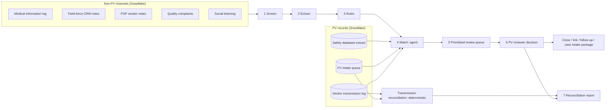

# Pharmacovigilance Sweep — Proof of Concept Definition

> Working name. Draft v0.3 (2026-11-22). Context: European Union, post-marketing pharmacovigilance.

## 1. Summary

Pharmacovigilance Sweep finds **adverse events recorded in non-pharmacovigilance systems that may never have
reached the pharmacovigilance (PV) department**: medical information enquiries, field-force CRM
notes, patient support programme (PSP) notes, product quality complaints and social listening.

It does two different jobs and uses AI only for the one that needs it:

1. **Transmission reconciliation (deterministic, no AI):** checks that everything a channel or
   vendor says it forwarded to PV was actually received.
2. **Source re-screening (AI-assisted):** re-reads the source records to surface adverse events
   that nobody passed to PV, including events that nobody linked to the product.

Every AI finding is a **potential case for PV assessment**, never a conclusion that a report was
missed. A PV reviewer assesses it with a guided checklist, and the outcome is logged for audit and
inspection: close, link, follow-up or case intake. A finding that missed a forwarding timeline or
a regulatory deadline also gets a deviation or compliance record.

The POC is a portfolio piece built on public and synthetic data. It is not a validated system and
does not connect to a real safety database.

## 2. Business problem

- A marketing authorisation holder (MAH) must collect and assess suspected adverse reactions from
  every source it is responsible for, including vendors acting on its behalf (call centres, PSP
  providers, market research agencies).
- The regulatory clock starts on **day 0**: the date on which any person in the MAH, or any party
  acting on its behalf, first holds the minimum information for a valid case. In the EU, serious
  cases are due within **15 calendar days** and non-serious cases within **90 days**. Significant
  follow-up information restarts the clock from the date that information is received
  ([GVP Module VI, VI.B.7](https://www.ema.europa.eu/en/documents/regulatory-procedural-guideline/guideline-good-pharmacovigilance-practices-gvp-module-vi-collection-management-submission-reports-suspected-adverse-reactions-medicinal-products-rev-2_en.pdf)).
- Information about adverse events often lands first in systems owned by other functions (medical
  information, commercial, patient services, quality). The clock runs from the moment those
  systems hold the information, whether or not PV knows about it. Every day lost there shortens
  the time PV has to assess and submit; a long enough delay becomes a late submission.
- Regulators have acted on exactly this risk. The EMA took action on deficiencies in Roche's
  safety reporting, including reports collected through a patient support programme that had not
  been evaluated as potential adverse reactions
  ([EMA](https://www.ema.europa.eu/es/news/european-medicines-agency-acts-deficiencies-roche-medicines-safety-reporting)).
  The UK inspectorate has also published its expectations for oversight of PSPs
  ([MHRA Inspectorate](https://mhrainspectorate.blog.gov.uk/2020/05/07/patient-support-programmes/)).

This document makes no claim about how any particular company performs these activities today.
The POC addresses a risk that regulators have explicitly highlighted.

## 3. Two distinct jobs

| | Transmission reconciliation | Source re-screening |
|---|---|---|
| Question | Did PV receive everything the channel or vendor says it sent? | Is there anything in the source records that nobody passed to PV? |
| Inputs | Vendor transmission log, PV intake log | Free-text source records |
| Method | Deterministic matching on identifiers, dates and counts | LLM screening and extraction, agent-assisted matching, human assessment |
| Typical finding | "Vendor sent 120 reports this month; PV logged 118" | "This PSP note records a hospital admission for an arrhythmia; nobody has assessed whether the product could be involved" |
| AI needed | No | Yes |

## 4. Scenario

- A **fictional MAH ("Contoso Pharma")** with a portfolio of four antidepressants: sertraline,
  escitalopram, duloxetine and venlafaxine. They are well represented in FAERS and carry
  well-known safety topics (such as hyponatraemia, serotonin syndrome and, for escitalopram, QT
  prolongation) that make realistic scenarios.
- Contoso markets them under **fictional brand names** (to be checked against EU product
  registers so they do not clash with real products).
- Working language: English. Multilingual handling is the first follow-on step.

## 5. Channels and report types

The report type matters (ICH E2D(R1) sections 3 and 5.1.1):

- **Spontaneous** reports are unsolicited communications from a healthcare professional or a
  consumer. Reporting implies a suspected causal relationship.
- **Solicited** reports come from an organised data collection system (ODCS), such as a PSP,
  market research or planned social listening. They need a causality assessment, and are
  reportable only if the reporter or the MAH judges a causal relationship at least a reasonable
  possibility.

| Channel | Simulated source system | Report type | Operated by | Data in POC |
|---|---|---|---|---|
| Medical information enquiries | MI log | Spontaneous | MAH or MI vendor | Synthetic |
| Field-force call notes | CRM | Spontaneous | MAH | Synthetic |
| Patient support programme | PSP vendor platform | **Solicited** (ODCS) | PSP vendor | Synthetic |
| Product quality complaints | Quality complaint system | Spontaneous | MAH Quality | Synthetic |
| Social listening programme (planned review of third-party patient forums) | Listening tool export | **Solicited** (ODCS) | MAH digital team or agency | Synthetic |

Notes:

- **PSP:** the MAH must review all information received in a PSP for adverse events (E2D(R1)
  4.5). A one-way service on its own, such as home delivery, is not a PSP; events reported
  through it are spontaneous.
- **Social listening:** MAHs are not expected to screen digital platforms they are not
  responsible for. When they do it in a planned way, the activity is an ODCS (E2D(R1) 2.8 and
  4.3.2):
  - it needs documentation: objectives, sources, dataset and look-back period, review method,
    and the process for adverse events;
  - reportable cases are solicited and need a causality assessment;
  - day 0 is the date the reviewer identifies an event with the minimum criteria, not the date
    of the post or of data access.
  An event an employee comes across by chance on a third-party site, outside any ODCS, is managed
  as spontaneous.
- **Market research** is also an ODCS (solicited) and is left for a later iteration.

## 6. What happens to each record

| Step | What it does | How |
|---|---|---|
| 1. Screen | Classifies the record at **adverse event level**, never at adverse reaction level: (a) adverse event in a person exposed, or possibly exposed, to a product, **whether or not anyone links it to the product** (e.g. "admitted for an arrhythmia"), with a flag for whether the four minimum criteria appear present; (b) special situation without an adverse event (overdose, medication error, pregnancy exposure); (c) no PV content. Classes (a) and (b) go to PV assessment. The screen never judges causality | Small LLM, fixed JSON schema |
| 2. Extract | Patient, reporter (healthcare professional or consumer), product, events (verbatim, coded term, supporting sentence), onset date, outcome, seriousness criteria (ICH E2A), **reporter's causality statement** (suspected / explicitly excluded / not stated), **event context** such as the reason for an admission or a procedure planned before treatment, and every date in the record | LLM, fixed JSON schema, evidence span per field |
| 3. Rules | Product ownership: own brand / active substance only (cannot exclude) / another MAH's brand. Important Medical Event (IME) flag. Report type from the channel, and a **"causality assessment required"** flag for solicited records without the reporter's assessment. **Dates and clocks**, see below | Deterministic code and SQL, no AI |
| 4. Match | Retrieves candidates with SQL blocking (substance, sex, age band, event term, date window) across the safety database, the PV intake queue and the vendor transmission log. The agent adjudicates: already in the safety database (case ID) / received and pending in the intake queue / **significant** follow-up to an existing case (which new facts) / **non-significant** follow-up (no new medical or administrative information) / duplicate within the sweep / no match found. Always returns a justification and a confidence level | Microsoft Agent Framework agent hosted in Foundry Agent Service, with read-only tools; deterministic retrieval, LLM proposal, reviewer confirms |
| 5. Prioritise | Orders the queue by seriousness (including IME), then days remaining to the regulatory deadline, then confidence | SQL |
| 6. Review | PV reviewer works the finding with the checklist in section 7 and records the outcome | Review app in Snowflake |
| 7. Report | Per channel, vendor and period: records screened, potential cases surfaced, outcomes after assessment, forwarding delays and breaches, regulatory status at detection, root-cause categories, transmission gaps | SQL views and dashboard |

Records screened as having no PV content are **never closed silently**: a configurable share is
routed to human quality control by sampling.

### Dates and clocks (step 3)

The rules keep three measures apart, because they mean different things:

| Measure | Definition | What a breach means |
|---|---|---|
| Forwarding delay | Days from receipt in the channel (by the MAH or its vendor) to receipt by PV, compared with the forwarding timeline in the safety data exchange agreement (SDEA) or the internal procedure. The timeline is a parameter (e.g. one business day) | Vendor or channel compliance finding. **Not** a late case |
| Regulatory status | Days from day 0 against 15 days (serious) or 90 days (non-serious): on time / at risk / overdue | Overdue: late submission and deviation record |
| Clock not started | The minimum criteria are not all present yet | Follow-up needed; no day 0 until the missing information arrives |

Day 0, as the rules propose it and the reviewer confirms it:

- **New case:** the date the MAH or a party acting on its behalf first held the four minimum
  criteria. For the social listening ODCS, the date the reviewer identified the event with the
  minimum criteria (E2D(R1) 4.3.2).
- **Significant follow-up** (new medical or administrative information that could change the
  assessment or seriousness, including non-serious becoming serious): the date the MAH or its
  vendor received that information. The case's initial receipt date stays unchanged, as in ICH
  E2B (first received vs most recent information).
- **Non-significant follow-up:** no new clock.

Example: a serious case reaches the PSP vendor on Monday and PV finds it on Thursday. Three days
have been lost and the forwarding timeline has been breached, but 12 days remain: the case is not
late. It is processed with priority and the breach is recorded against the vendor.

## 7. What PV does with a finding

### Reviewer checklist

The system pre-fills each item from the text where it can and marks what the reviewer must
confirm.

1. **Already received through another route?** Safety database, intake queue, vendor
   transmission log. If so, does the record add significant information?
2. **Is there an adverse event, and could the product have caused it?**
   - Spontaneous source: a causal relationship is implied. If the reporter explicitly excludes
     it, record that and whether PV agrees.
   - Solicited source: use the reporter's assessment if stated; otherwise a PV physician assesses
     it. Reportable only if at least a reasonable possibility.
   - Context: reason for the admission, procedures planned before treatment, underlying disease.
3. **Are the four minimum criteria present?** Identifiable patient, identifiable reporter,
   suspect product, suspected reaction.
4. **Is it our product?**
5. **Seriousness**, including the IME list.
6. **Dates:** confirm day 0 (new case) or the receipt date of the significant follow-up
   information.

The causality judgement here only decides whether a solicited event is reportable. Full case
assessment, including expectedness, stays in the standard case-processing workflow, outside the
POC.

### Outcomes

| Outcome | Action |
|---|---|
| A. Not reportable: no adverse event (e.g. an admission for a procedure planned before treatment started), or a solicited event assessed as not related | Close with documented rationale. Solicited events stay recorded with their causality assessment |
| B. Already received, no new significant information | Link to the safety database case or intake item; close |
| C. Potential case, minimum criteria incomplete | Draft a follow-up request to the vendor or healthcare professional; track until answered. The clock starts when the criteria are complete |
| D. Valid ICSR, new or significant follow-up | Create a case intake package with the initial receipt date, day 0 for this submission and the days remaining. Record a compliance finding if the forwarding timeline was breached; process with priority if the deadline is at risk; if overdue, flag as a late submission and open a deviation record |

### Delays, late cases, root cause and CAPA

- Each forwarding breach and each late submission gets a root-cause category: not recognised by
  channel staff; recognised but not forwarded; forwarded but not received; received but not
  processed.
- Typical corrective and preventive actions: retraining, redesign of the channel's capture form,
  changes to the vendor contract or SDEA, more frequent reconciliation.
- Every sweep keeps its scope, findings, reviewer decisions, compliance findings, deviations and
  CAPAs, so the MAH can show an inspector both the control and its results.

## 8. Data

Each source is checked twice: the licence of the dataset as published, and the rights over the
original text it contains. A source is used only when both allow use in a public, self-promotional
portfolio. Datasets are downloaded at deploy time with pinned revisions and attribution; no
third-party data or terminology is committed to the repository.

| Purpose | Source | Dataset licence | Original source | Notes |
|---|---|---|---|---|
| Simulated safety database | FAERS, Parquet copy on Hugging Face ([alexcpn/fda-faers-parquet](https://huggingface.co/datasets/alexcpn/fda-faers-parquet)) | CC0 | US FDA public data | Subset: EU reporting countries and the four substances. Real brand names are remapped to Contoso's fictional brands by active substance. Covers reports received June 2022 to December 2024, with about 11,000 EU/EEA cases for the four substances; dates are shifted by a fixed offset. FAERS keeps only the latest version of each case, so version history for follow-up scenarios is synthetic |
| PV intake queue, vendor transmission log | Synthetic | — | — | Generated from the scenarios below |
| MI, CRM, PSP, quality complaint and social listening records | Synthetic, about 450 records | — | — | Scenario-first generation (see below). Social listening posts are written in forum style |
| External benchmark (separate track) | VAERS narratives with coded symptoms ([chrisvoncsefalvay/vaers-narrative-generation](https://huggingface.co/datasets/chrisvoncsefalvay/vaers-narrative-generation)) and outcomes ([chrisvoncsefalvay/vaers-outcomes](https://huggingface.co/datasets/chrisvoncsefalvay/vaers-outcomes)) | CC0 / Apache 2.0 | US CDC and FDA public data | The real-text track, on pinned samples. Coding is measured on the narratives with coded symptoms; seriousness on the outcomes dataset, limited to hospitalisation and death (an emergency-room visit is not an ICH E2A criterion). The two datasets share no ID. Vaccines, not part of the business demo |

**Not used: real patient-forum corpora.** The annotated corpora that would fit the social
listening channel, PsyTAR and CADEC, are both built from AskaPatient posts. CADEC is released for
research use only. Hugging Face lists PsyTAR as CC BY 4.0, but that licence does not establish
commercial rights over the patient-written text. Until those rights are clear, the POC uses no
real forum text. A
bring-your-own-data loader, like the MedDRA adapter, lets someone with the rights plug in a real
corpus.

### Scenario-first synthetic data

The ground truth is defined first as structured scenarios; an LLM only writes the text in the
style of each channel, and a validator checks that every planted fact appears in it. Each
scenario carries **two gold labels**: the expected screening class (step 1) and the expected
reviewer outcome (step 6). An admission that turns out to be unrelated is labelled "adverse
event, route to PV" at screening and "outcome A" at review, so screening it out counts as a miss.

The scenario mix covers:

- already in the safety database (derived from a FAERS case and rewritten in channel style);
- received and pending in the intake queue;
- significant follow-up (e.g. a new admission or outcome, or non-serious becoming serious) and
  non-significant follow-up (repeated information);
- new adverse event from a spontaneous channel, including one where the reporter explicitly
  excludes the product;
- new adverse event in a PSP note, with and without a causality statement, including an admission
  described with no reference to the product;
- admission for a procedure planned before treatment;
- special situations without an adverse event (overdose, medication error, pregnancy exposure);
- incomplete reports (e.g. no identifiable reporter, common in forum posts);
- another MAH's product;
- channel noise with no PV content (availability, pricing, logistics);
- timing variants: found within the forwarding timeline; forwarding timeline breached but
  regulatory deadline met; regulatory deadline missed;
- transmission gaps between the vendor log and the intake log.

Text generation is split between the two providers, so neither is evaluated only on text it
wrote itself; results are reported by generator, and results on synthetic and real text are always
reported separately.

### Terminology

- **Demo mode:** events are coded to Preferred Term (PT) names from a vocabulary built at deploy
  time from the public datasets. It is not presented as MedDRA.
- **Production mode:** an adapter loads a licensed MedDRA release supplied by the user and codes
  at Lowest Level Term (LLT), following the MedDRA term selection guidance. MedDRA content is
  never committed.
- **IME list:** applied as a deterministic rule on coded terms. The EMA list is not offered as a
  public download and is built on MedDRA terms, so it follows the same bring-your-own approach: a
  loader for a file supplied by the user. Demo mode uses a short list of serious-event terms
  defined by the project for the scenarios, labelled as not the EMA list.

## 9. KPIs

Business KPIs are **simulated from the scenario ground truth** in the POC. They would only be
measured with real reviewers in a pilot.

| Area | KPI |
|---|---|
| Business | Potential cases surfaced per channel; share confirmed after PV assessment; share already received through another route; forwarding delay and breaches per channel and vendor; regulatory status at detection (days remaining, overdue); share of records requiring human review; transmission gaps per vendor |
| Model quality | Screening recall of records with an adverse event or special situation, measured against the screening gold label (primary metric, provisional target ≥ 95 %); precision; matching accuracy across the match outcomes, including significant vs non-significant follow-up; recall of serious cases; accuracy of the causality-statement extraction; coding F1 on the VAERS benchmark; run-to-run consistency (3 runs per record) |
| Engineering | Cost per 1,000 records per model; latency p50 and p95; failure rate; GPT vs Claude on identical evaluations; cost-based routing (small model for screening, large model for matching) |

All targets are provisional.

## 10. Demo storyline (3–5 minutes)

1. **Transmission reconciliation:** the PSP vendor log shows two reports that never reached the
   PV intake log.
2. **A finding that is confirmed:** a PSP nurse note says the patient "was admitted for an
   arrhythmia", with no mention of the product as a cause. No match in the safety database, the
   intake queue or the vendor log.
   - The screen routes it as an adverse event, and the rules flag it as solicited with a
     causality assessment required.
   - The PV physician judges a reasonable possibility (the patient takes Contoso's escitalopram
     brand) and confirms a valid ICSR.
   - The vendor recorded the note three days earlier: the forwarding timeline was breached, but
     12 days remain. The system produces the case intake package, records a compliance finding
     against the vendor with a root cause, and puts the case at the top of the queue.
   - A variant with older dates shows the late-submission path and its deviation record.
3. **A finding that is not:** another admission turns out to be already pending in the intake
   queue, or a procedure planned before treatment. The system links or closes it with a
   rationale.
4. **Reconciliation report** per channel and vendor.
5. **Model comparison:** GPT vs Claude on quality, consistency, cost and latency.

## 11. Architecture (overview)

Full detail, flows and decisions: [architecture.md](architecture.md).

- **Snowflake:** source and PV data, results, matching views, reconciliation, review app
  (Streamlit in Snowflake) and reports. Role-based access and masking for personal data
  (Enterprise edition).
- **Azure:**
  - Microsoft Foundry with GPT deployments as EU Data Zone Standard and Claude deployments
    Hosted on Azure as Global Standard (Claude on Foundry offers no EU data zone; acceptable for
    synthetic data, a decision point for production);
  - the matching agent (step 4) built with Microsoft Agent Framework and run as hosted agents in
    Foundry Agent Service, one per provider from the same code;
  - Foundry guardrails on the agents and the GPT deployments, and model evaluations as custom
    evaluators in Foundry;
  - orchestration as an Azure Container Apps job, because Snowflake trial accounts do not allow
    external network access (on a paid account, model calls can move into Snowflake through an
    External Access Integration);
  - Key Vault and managed identity;
  - tracing through Application Insights and Foundry.
- **Delivery:** Bicep for Azure, versioned SQL migrations for Snowflake, GitHub Actions with OIDC.
  One command deploys from scratch and one tears down, after a few one-time manual steps
  (accounts, Marketplace terms for Claude, Snowflake bootstrap). The evaluation suite runs in CI
  and fails the pipeline if recall drops below the threshold.
- **Model access:** a provider-agnostic interface. Model and prompt versions are stored with every
  output.

## 12. Out of scope

- Regulatory submission (E2B) and any connection to a real safety database.
- Expectedness assessment and full case assessment. The POC never assesses causality itself: a
  person records it in the review app.
- Real patient data.
- Languages other than English.
- Real-time processing.
- GxP validation.

## 13. Known limitations

- Internal channels are synthetic and may be easier than real records; mitigated by
  scenario-first generation, a validator, hand review of a sample and separate reporting of the
  real-text track.
- No real forum text: social listening is synthetic until a corpus with clear commercial rights
  is available.
- Dates are planted in the synthetic records. Real systems often have unreliable or missing
  receipt timestamps, and every clock rule depends on them.
- FAERS is structured data without narratives, mostly US-centred, ends in December 2024 and keeps
  only the latest version of each case.
- VAERS covers vaccines and is used only as an external benchmark.
- Demo-mode coding is at PT level; production requires a licensed MedDRA release at LLT level.
- Business KPIs are simulated and would need a pilot with real reviewers.

## 14. Open decisions

1. Snowflake account type: trial (orchestration in Azure) or paid (model calls can run inside
   Snowflake).
2. Data residency for a production version: Claude on Foundry runs as Global Standard or in a US
   data zone only, so personal data would need pseudonymisation before model calls or a GDPR
   transfer assessment. For the POC: which region offers the chosen GPT models as EU Data Zone
   Standard and Claude Hosted on Azure.
3. Agent runtime, decided: Microsoft Agent Framework hosted in Foundry Agent Service
   (architecture ADR-004), subject to the spike in section 17 of the architecture. Fallback: the
   same agent package run in-process by the runner.
4. Real forum text: ask the rights holder for commercial use of an annotated corpus, or stay
   synthetic.
5. Fictional brand names: Sertavix, Escitrel, Duloxane and Venlaris are used (`config/brands.json`);
   still to be checked against EU product registers before publication.
6. Optional extras: conversational assistant for the PV operations manager, Azure API Management
   as a model gateway, multilingual intake, a Databricks variant documented as an architecture
   decision record.

## 15. References

- EMA, Good Pharmacovigilance Practices, Module VI (Rev 2): collection, management and submission
  of reports of suspected adverse reactions to medicinal products. Sections VI.B.7 (day 0,
  follow-up clock) and VI.C.6.2.2.7 (significant follow-up)
  ([EMA](https://www.ema.europa.eu/en/documents/regulatory-procedural-guideline/guideline-good-pharmacovigilance-practices-gvp-module-vi-collection-management-submission-reports-suspected-adverse-reactions-medicinal-products-rev-2_en.pdf)).
- ICH E2D(R1): post-approval safety data, definitions and standards for management and reporting
  of individual case safety reports. Sections 2.8 (ODCS), 3 (report types), 4.3.2 (third-party
  digital platforms), 4.5 (PSPs), 5.1.1 (causality), 5.2 (timeframes)
  ([EMA](https://www.ema.europa.eu/en/documents/scientific-guideline/ich-e2dr1-guideline-post-approval-safety-data-definitions-standards-management-reporting-individual-case-safety-reports-step-5_en.pdf)).
- ICH E2A: clinical safety data management, definitions of seriousness.
- EMA: action on deficiencies in Roche medicines safety reporting
  ([link](https://www.ema.europa.eu/es/news/european-medicines-agency-acts-deficiencies-roche-medicines-safety-reporting)).
- MHRA Inspectorate: patient support programmes
  ([link](https://mhrainspectorate.blog.gov.uk/2020/05/07/patient-support-programmes/)).
- Anthropic: Claude in Microsoft Foundry
  ([docs](https://platform.claude.com/docs/en/build-with-claude/claude-in-microsoft-foundry)).
- MedDRA Term Selection: Points to Consider (MSSO).
- EMA Important Medical Event (IME) terms list.
